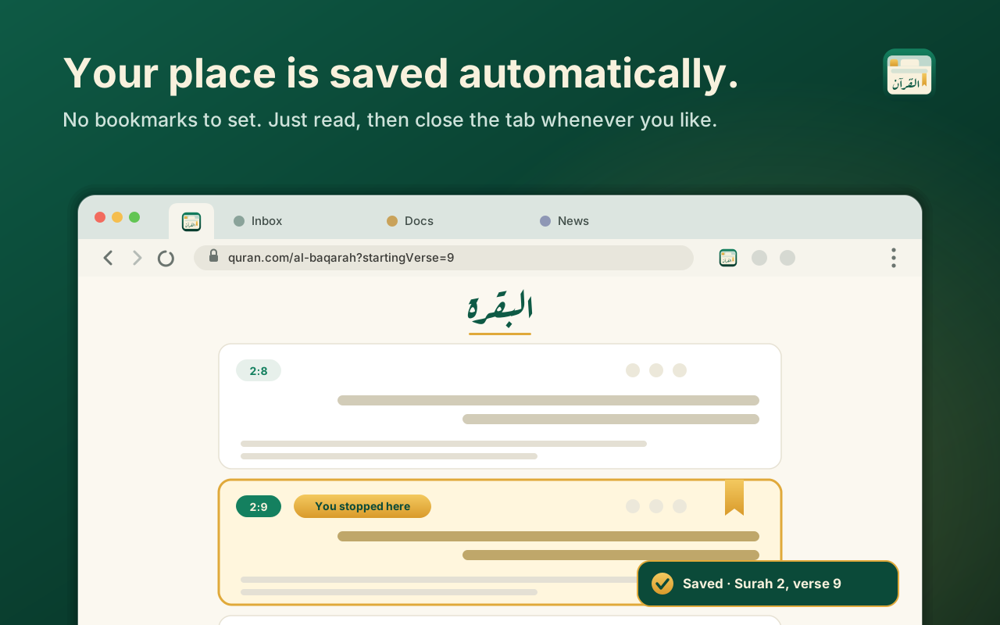
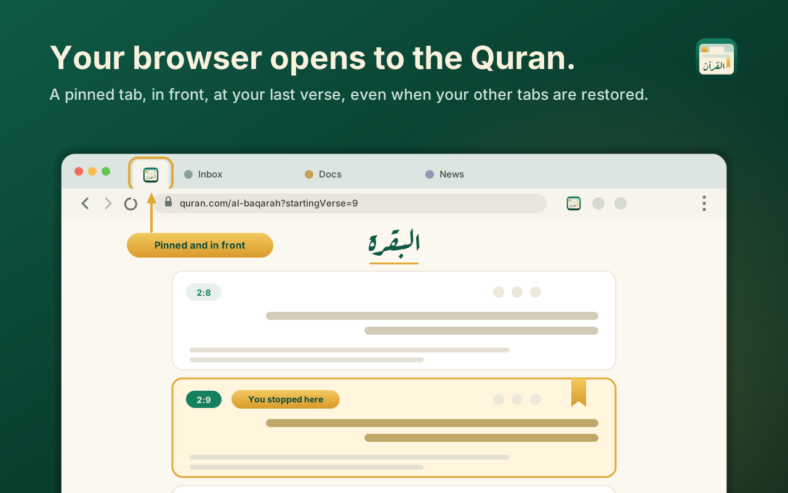

<p align="center">
  
</p>

<h1 align="center">Quran Resume</h1>

<p align="center">
  Opens quran.com at the verse you stopped on, in a pinned tab, every time your browser starts.
</p>

<p align="center">
  <a href="../../releases/latest"><b>Download</b></a> ·
  <a href="#install"><b>Install</b></a> ·
  <a href="#how-it-works"><b>How it works</b></a> ·
  <a href="#privacy"><b>Privacy</b></a> ·
  <a href="#build-from-source"><b>Build from source</b></a> ·
  <a href="LICENSE"><b>MIT License</b></a>
</p>

<br>

Quran Resume is a small browser extension for [quran.com](https://quran.com). It remembers the verse you were
reading and, the next time your browser starts, opens the whole surah in a pinned tab, scrolled to that verse and
in front of everything else.

- Remembers your place automatically as you scroll. There is nothing to click or save.
- Opens on every browser startup, as a **pinned tab that is the one you see first**, even when your browser's
  "continue where you left off" brings back all your other tabs.
- Opens the **whole surah** at your verse, not a single-verse view, so you can keep reading in either direction.
- If your browser restored a quran.com tab, it reuses it instead of opening a second one.
- A toolbar icon takes you to your last verse at any time.
- No account, no analytics, and no network requests of its own. It saves only your last verse, on your device.

Works in Chrome and other Chromium browsers (Edge, Brave, Ecosia and so on).

<table>
  <tr>
    <td align="center" width="50%">
      <br>
      <sub>Your place is saved as you read.</sub>
    </td>
    <td align="center" width="50%">
      <br>
      <sub>Next startup, it opens pinned and in front.</sub>
    </td>
  </tr>
</table>

<sub>These images are illustrations. They use placeholder text lines rather than real verses.</sub>

## Install

**From the Chrome Web Store:** coming soon. The link will be added here once it is listed.

**Or by hand:**

1. Download `quran-resume-<version>.zip` from the [Releases](../../releases) page and unzip it into a folder you
   will keep (the browser reads the extension from that folder, so don't delete it).
2. Open `chrome://extensions` (or `edge://extensions`, `ecosia://extensions`) and turn on **Developer mode**.
3. Click **Load unpacked** and choose the unzipped folder.
4. Open quran.com and read. Next time your browser starts, the Quran tab opens at your last verse.

Chrome on Windows may show a "Disable developer mode extensions" notice each time it starts, because the extension
was loaded by hand. The Chrome Web Store version doesn't have that.

Prefer to read the code first? It is all in this repository, and there is no build step (below).

## Use

| Do this | What happens |
|---------|--------------|
| Read on quran.com | Your place is saved as you scroll (once you've scrolled, clicked or pressed a key) |
| Start your browser | A pinned quran.com tab opens at your last verse and is brought to the front (you can turn this off in the menu) |
| Come back after a break | Once a day, the first time your computer wakes from sleep or is unlocked with the browser open, the Quran tab comes to the front and a small prompt lets you switch this off or stop showing the prompt. It is on by default; the switch is also in the extension's options (right-click the icon, then Options) |
| Press Alt+Shift+Q (Option+Shift+Q on a Mac) | Jumps to your Quran tab at your last verse from anywhere (change it at `chrome://extensions/shortcuts`) |
| Use Chrome on another computer | With **Sync my place** on, your last verse follows you through Chrome sync. The newest place wins |
| Click the toolbar icon | A menu shows the chapter and verse you last stopped at, an **Open Quran** button, the switches for startup, wake-from-sleep and sync, and a link to talk to the developer |

The first time, before anything has been saved, it opens Al-Fatihah.

## How it works

- **Saving your place.** A small script on quran.com notes which verse is nearest the top of the screen, using
  the verse markers the page already has (`data-verse-key`), and stores it in the browser's extension storage.
  It saves while you scroll, so it doesn't matter how you close the tab or the browser. It starts saving only
  after you scroll, click, touch or press a key, so a tab your browser restored but you haven't touched can never
  overwrite your real place.
- **Opening on startup.** About two seconds after the browser starts (to let it finish restoring tabs), the
  extension looks for an open quran.com tab. It reuses it, or opens a new one, pinned, at
  `https://quran.com/<surah>?startingVerse=<verse>`. That address shows the whole surah positioned at your verse;
  the plain `quran.com/<surah>/<verse>` form shows only that one verse.
- **Staying in front.** Session restore can finish after the extension runs and switch to another tab, so the
  Quran tab is brought to the front again at 0, 1.5, 3.5 and 6 seconds.

## Privacy

Your last verse (for example `2:9`) and the time it was saved are kept in your browser's local extension storage and
never leave your device. The extension has no analytics, makes no network requests of its own, loads no remote code,
and needs no account. Your place only leaves your device if you use Chrome sync, and then it travels through Chrome's own sync to your other signed-in browsers (you can turn it off in the menu). Its permissions are `storage`, `idle` and `alarms` (to notice that the computer woke up, nothing more) and access to `https://quran.com/*`. The full policy is in
[PRIVACY.md](PRIVACY.md).

## What it can't do

- It remembers one place, your last verse. It doesn't keep bookmarks or separate places per surah, and it doesn't
  sync between devices or touch your quran.com account or its own "last read".
- It relies on how quran.com marks up its pages. If they change it, saving your place could stop working until the
  selector at the top of [content.js](content.js) is updated. Please open an issue if that happens.
- It acts when the browser starts. Opening a new window later doesn't do it; click the toolbar icon instead.
- If your browser is very slow to restore tabs, the Quran tab may not stay in front. It makes its last attempt about
  six seconds after startup.

## Build from source

There is no build step. The extension is three small files and an icon set, so you can load this folder directly
with **Load unpacked**.

```bash
./release.sh    # makes dist/quran-resume-<version>.zip, the file for the Chrome Web Store and for GitHub Releases
./publish.sh    # runs release.sh, then creates the GitHub release (needs the gh CLI, signed in)
```

`./publish.sh` uses [release-notes/v1.3.0.md](release-notes/v1.3.0.md) (the file named after the tag) for the release
text if it exists. The version number comes from [manifest.json](manifest.json).

| File | What it does |
|------|--------------|
| [manifest.json](manifest.json) | Extension description, permissions and icons |
| [background.js](background.js) | Opens and focuses the Quran tab on startup, on a toolbar click, and once a day when you return from a break |
| [popup.html](popup.html), [popup.css](popup.css), [popup.js](popup.js), [surahs.js](surahs.js) | The toolbar menu: last verse, once-a-day switch, link to the developer |
| [options.html](options.html), [options.js](options.js) | The on/off switch for the return-from-break behaviour |
| [content.js](content.js) | Runs on quran.com and saves the verse you are on |
| [icons](icons) | The logo as SVG and the PNG sizes the browser needs |

`python3 tools/render-icons.py` redraws the PNG icons and the README logo from [icons/icon.svg](icons/icon.svg)
(it needs `pip install cairosvg`). The [store](store) folder holds the Chrome Web Store listing text and promo tile.

### About the logo

The logo is an original design and is not derived from quran.com's. The word القرآن is outlined from the
[Aref Ruqaa](https://fonts.google.com/specimen/Aref+Ruqaa) typeface, licensed under the
[SIL Open Font License 1.1](https://openfontlicense.org). In Ruqaa the two dots of qaf are written as one dash and the
dot of nun joins the bowl, so those dots were redrawn as separate dots in the same pen-shape.

## Uninstall

Open `chrome://extensions`, find Quran Resume and choose **Remove**. That also deletes the verse it saved. Nothing
else is left behind.

## Disclaimer

This is an independent project. It is not affiliated with, endorsed by, or sponsored by Quran.com or the Quran
Foundation.
