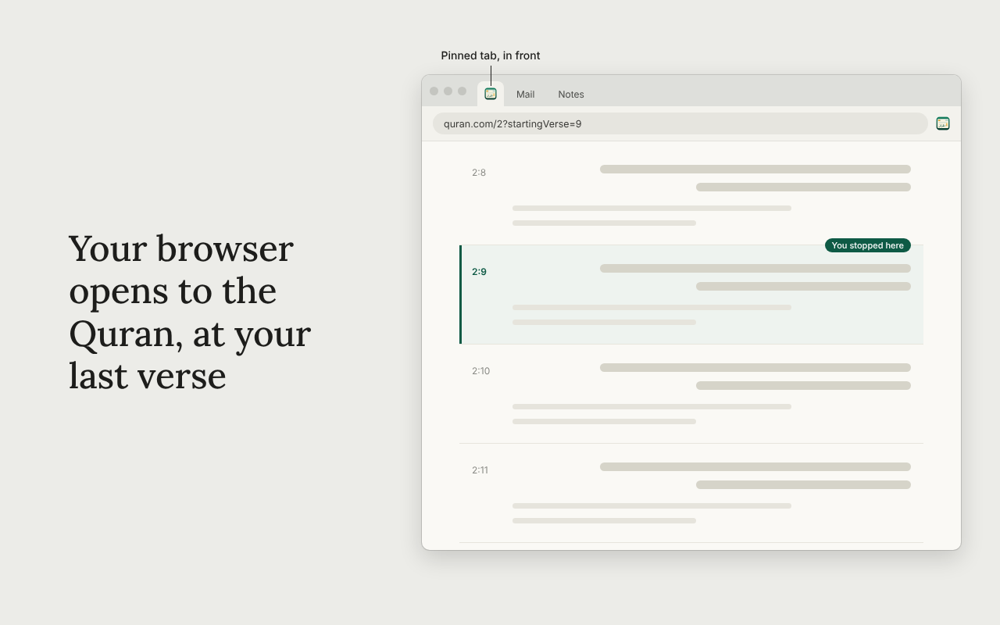
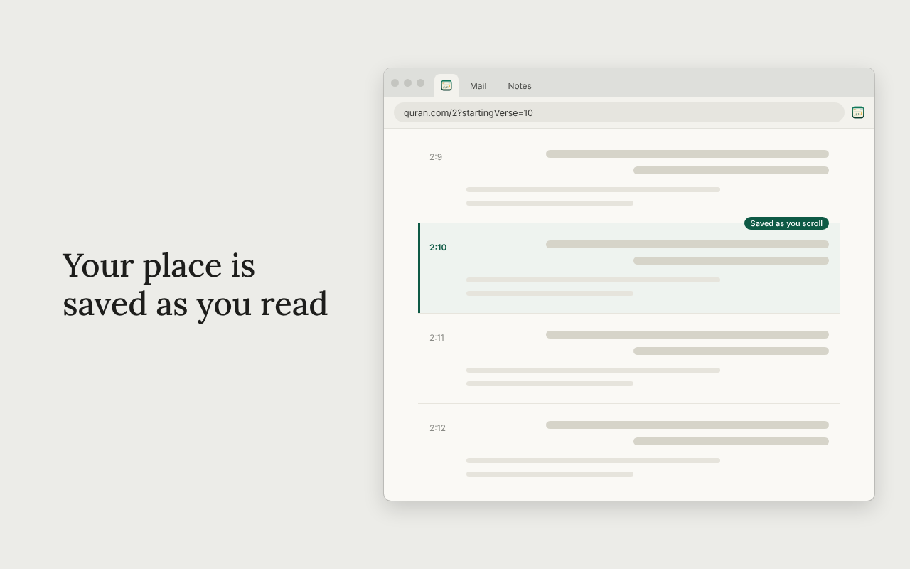

<p align="center">
  
</p>

<h1 align="center">Quran Resume</h1>

<p align="center">
  Opens quran.com at the verse you stopped on when your browser starts.
</p>

<p align="center">
  <a href="../../releases/latest"><b>Download</b></a> ·
  <a href="#install"><b>Install</b></a> ·
  <a href="#how-it-works"><b>How it works</b></a> ·
  <a href="#privacy"><b>Privacy</b></a> ·
  <a href="#build-from-source"><b>Build from source</b></a> ·
  <a href="LICENSE"><b>MIT License</b></a>
</p>

<br>

Quran Resume is a small extension for [quran.com](https://quran.com). It remembers the verse you were reading.
When your browser starts, it opens that surah in a pinned tab, scrolled to the verse, in front of your other tabs.

- Saves your place as you scroll. There is nothing to click.
- Opens on browser startup as a pinned tab you see first, even when the browser restores all your old tabs.
- Opens the whole surah at your verse rather than a single-verse view, so you can read in either direction.
- Reuses a quran.com tab the browser already restored instead of opening a second one.
- Once a day, the first time your computer wakes or unlocks with the browser open, it brings the Quran tab to the front.
  You can turn this off.
- Can sync your place to your other computers through Chrome sync.
- No account and no analytics. It makes no network requests of its own.

Works in Chrome and other Chromium browsers (Edge, Brave, Ecosia and so on).

<table>
  <tr>
    <td align="center" width="50%">
      <br>
      <sub>Opens in a pinned tab, in front, at your verse.</sub>
    </td>
    <td align="center" width="50%">
      <br>
      <sub>Saved as you scroll.</sub>
    </td>
  </tr>
</table>

<p align="center"><sub>The pages are drawn with placeholder lines instead of verses. The menus and prompts in <a href="store/screenshots">store/screenshots</a> are the real thing.</sub></p>

## Install

**From the Chrome Web Store:** coming soon. The link will be added here once it is listed.

**Or by hand:**

1. Download `quran-resume-<version>.zip` from the [Releases](../../releases) page and unzip it into a folder you
   will keep. The browser reads the extension from that folder, so don't delete it.
2. Open `chrome://extensions` (or `edge://extensions`, `ecosia://extensions`) and turn on **Developer mode**.
3. Click **Load unpacked** and choose the unzipped folder.
4. A welcome page opens. Pick where you want to begin, then close and reopen the browser.

Chrome on Windows may show a "Disable developer mode extensions" notice each time it starts, because the extension
was loaded by hand. The Chrome Web Store version doesn't have that.

Prefer to read the code first? It is all in this repository, and there is no build step.

## Use

| Do this | What happens |
|---------|--------------|
| Read on quran.com | Your place is saved as you scroll, once you have scrolled, clicked or pressed a key |
| Start your browser | A pinned quran.com tab opens at your last verse and comes to the front |
| Wake or unlock your computer | The first time each day, the Quran tab comes to the front and a small prompt lets you turn this off |
| Press Alt+Shift+Q (Option+Shift+Q on a Mac) | Jumps to your Quran tab at your last verse. Change the keys at `chrome://extensions/shortcuts` |
| Click the toolbar icon | Shows your last chapter and verse, an Open Quran button, the switches, and a link to message the developer |

Before anything has been saved it opens Al-Fatihah, or the place you picked on the welcome page.

## How it works

- Saving your place. A small script on quran.com notes which verse is nearest the top of the screen, using the verse
  markers the page already has (`data-verse-key`), and stores it in the browser's extension storage. It saves while
  you scroll, so it doesn't matter how you close the tab or the browser. It starts saving only after you scroll,
  click, touch or press a key, so a restored tab you haven't touched can't overwrite your real place.
- Opening on startup. About two seconds after the browser starts, to let it finish restoring tabs, the extension looks
  for an open quran.com tab. It reuses it, or opens a new pinned one, at
  `https://quran.com/<surah>?startingVerse=<verse>`. That address shows the whole surah positioned at your verse. The
  plain `quran.com/<surah>/<verse>` form shows only that one verse.
- Staying in front. Session restore can finish after the extension runs and switch to another tab, so the Quran tab is
  brought forward again at 0, 1.5, 3.5 and 6 seconds.
- Waking up. The extension notices an unlock, or a gap in a one-minute timer that means the computer slept. It acts
  on the first one each calendar day.
- Syncing. With Sync my place on, the last verse is also written to Chrome's sync storage, and the newest save wins.

## Privacy

Your last verse (for example `2:9`) and the time it was saved are kept in your browser's extension storage. The
extension never sends them anywhere. If you use Chrome sync and leave Sync my place on, Chrome keeps a copy in its own
sync storage and syncs it to your other signed-in browsers. There are no analytics, no remote code and no account.

Permissions: `storage`, `idle` and `alarms` (to notice that the computer woke up), and access to `https://quran.com/*`.
The full policy is in [PRIVACY.md](PRIVACY.md).

## What it can't do

- It remembers one place, your last verse. There are no bookmarks, and it doesn't touch your quran.com account or its
  own "last read".
- It relies on how quran.com marks up its pages. If they change it, saving your place could stop working until the
  selector at the top of [content.js](content.js) is updated. Please open an issue if that happens.
- Sync needs a browser that has Chrome sync. Without it, your place stays on that computer.
- It acts when the browser starts and on the first wake each day. Opening a new window later doesn't do it. Use the
  toolbar icon or the shortcut instead.
- If your browser is very slow to restore tabs, the Quran tab may not stay in front. Its last attempt is about six
  seconds after startup.

## Build from source

There is no build step. Load this folder with **Load unpacked**.

```bash
./release.sh    # makes dist/quran-resume-<version>.zip, the file for the Chrome Web Store and for GitHub Releases
./publish.sh    # runs release.sh, then creates the GitHub release (needs the gh CLI, signed in)
```

`./publish.sh` uses `release-notes/<tag>.md` for the release text if it exists. The version number comes from
[manifest.json](manifest.json).

| File | What it does |
|------|--------------|
| [manifest.json](manifest.json) | Description, permissions, icons and the shortcut |
| [background.js](background.js) | Opens and focuses the Quran tab on startup, on wake, on the shortcut, and syncs your place |
| [content.js](content.js) | Runs on quran.com, saves the verse you are on and shows the wake prompt |
| [popup.html](popup.html), [popup.css](popup.css), [popup.js](popup.js) | The toolbar menu |
| [welcome.html](welcome.html), [welcome.css](welcome.css), [welcome.js](welcome.js) | The page shown once after install |
| [options.html](options.html), [options.js](options.js) | The options page |
| [surahs.js](surahs.js) | Surah names and verse counts |
| [icons](icons) | The logo as SVG and the PNG sizes the browser needs |

`python3 tools/render-icons.py` redraws the PNG icons and the README logo from [icons/icon.svg](icons/icon.svg)
(it needs `pip install cairosvg`). The [store](store) folder holds the Chrome Web Store listing text, promo tile and
screenshots.

### About the logo

The logo is an original design and is not derived from quran.com's. The word القرآن is outlined from the
[Aref Ruqaa](https://fonts.google.com/specimen/Aref+Ruqaa) typeface, licensed under the
[SIL Open Font License 1.1](https://openfontlicense.org). In Ruqaa the two dots of qaf are written as one dash and the
dot of nun joins the bowl, so those dots were redrawn as separate dots in the same pen-shape.

## Uninstall

Open `chrome://extensions`, find Quran Resume and choose **Remove**. That also deletes the verse it saved. Nothing
else is left behind.

## Disclaimer

This is an independent project. It is not affiliated with, endorsed by, or sponsored by Quran.com or the Quran
Foundation.
